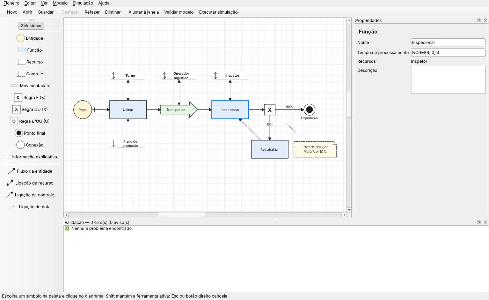

# IDEF-SIM Studio

Programa desktop para **criar, documentar, validar e simular** modelos conceituais
na técnica **IDEF-SIM** (Leal, Almeida & Montevechi, 2008), usada na
simulação a eventos discretos.



## Funcionalidades

| Área | O que faz |
|---|---|
| **Editor gráfico** | Paleta com todos os símbolos IDEF-SIM. Pode arrastar, encaixar na grelha, fazer zoom (Ctrl+roda), duplicar (Ctrl+D), eliminar, desfazer e refazer. |
| **Propriedades** | Nome, descrição e parâmetros de cada elemento: chegadas, tempos, capacidades e probabilidades. |
| **Validação** (F7) | Erros e avisos em tempo real: elementos sem fluxo, distribuições inválidas, conectores sem par, probabilidades, elementos inalcançáveis… Clique numa mensagem para ir ao elemento. |
| **Simulação** (F5) | Motor de eventos discretos (SimPy) que executa o próprio diagrama, com replicações, aquecimento, média, desvio padrão e IC 95%. Os resultados exportam para CSV. |
| **Gestão de modelos** | Ficheiros `.idefsim` (JSON legível e versionável), metadados (autor, versão e descrição), ficheiros recentes e modelos de exemplo. |
| **Documentação** | Exportação do diagrama em PNG ou SVG e do dicionário do modelo conceitual em HTML (com o diagrama embutido). |

## Instalação e execução

```bash
cd idefsim-studio
python -m venv .venv
# Windows: .venv\Scripts\activate    Linux/macOS: source .venv/bin/activate
pip install -r requirements.txt
python main.py                       # ou: python main.py examples/usinagem_inspecao.idefsim
```

### Gerar um executável (.exe / app)

```bash
pip install pyinstaller
pyinstaller --noconfirm --windowed --name "IDEF-SIM Studio" main.py
# resultado em dist/IDEF-SIM Studio/
```

### Testes

```bash
pip install pytest
python -m pytest
```

## Como modelar

1. Escolha um símbolo na paleta (ou use o atalho) e clique no diagrama. **Shift** mantém a ferramenta ativa; **Esc** ou o botão direito volta a *Selecionar*.
2. Para ligar dois elementos, escolha a ligação (*Fluxo*, *Recurso*, *Controle* ou *Nota*), clique na origem e depois no destino.
3. Edite os parâmetros no painel **Propriedades**. Sem nada selecionado, o painel mostra as propriedades do modelo (duração, aquecimento, replicações, unidade de tempo).
4. **F7** valida o modelo e **F5** executa a simulação.

### Símbolos e semântica de simulação

| Símbolo | Atalho | Interpretação na simulação |
|---|---|---|
| Entidade (círculo) | E | Sem fluxo de entrada é uma **fonte de chegadas** (intervalo, primeira chegada, lote, máximo). Com fluxo de entrada é uma **transformação**: a entidade passa a ser deste tipo. |
| Função (retângulo) | F | Apreende 1 unidade de cada recurso ligado, processa durante o tempo definido e liberta os recursos. Sem recurso, capacidade infinita. |
| Recurso | R | Capacidade (n.º de unidades). Liga-se à função com *Ligação de recurso* (seta dupla). |
| Controle | C | Documental. Liga-se à função com seta tracejada. |
| Movimentação (seta larga) | M | Como a função, mas representa um transporte. |
| Regra E (&) | 1 | Várias entradas: espera uma entidade de cada ramo (junção ou montagem). Várias saídas: segue por todos os ramos (paralelo). |
| Regra OU (X) | 2 | Segue **uma** saída, escolhida pelas probabilidades. |
| Regra E/OU (O) | 3 | Cada saída é seguida de forma independente com a sua probabilidade (pelo menos uma). |
| Ponto final | X | A entidade sai do sistema (contabiliza o tempo no sistema). |
| Conexão | K | Conectores com o **mesmo nome** estão ligados (útil para diagramas grandes). |
| Informação explicativa | N | Nota de texto, sem efeito na simulação. |

**Distribuições** (notação semelhante à do Arena): `5`, `CONST(5)`, `EXPO(média)`,
`NORM(média, desvio)`, `TRIA(mín, moda, máx)`, `UNIF(mín, máx)`, `LOGN(média, desvio)`,
`ERLA(média, k)`, `WEIB(escala, forma)`. Para vírgula decimal, separe os argumentos
com `;`, por exemplo `NORM(5,5; 0,8)`.

### Indicadores calculados

* **Sistema:** saídas, throughput, WIP médio e final, tempo médio no sistema.
* **Entidade:** criadas, saídas, tempo médio e máximo no sistema.
* **Função/Movimentação:** atendimentos, tempo médio de processamento, tempo médio em fila, fila média e máxima.
* **Recurso:** utilização (%) e ocupação média.
* **Ponto final:** entidades por saída.

Todos os indicadores têm média, desvio padrão, IC 95% (t de Student) e mínimo–máximo entre replicações.
Durante o aquecimento as estatísticas não são recolhidas.

## Estrutura do código

```
idefsim/
  model.py          modelo de dados e regras de ligação (sem dependência de Qt)
  distributions.py  leitura e amostragem de distribuições
  validation.py     verificação de consistência
  simulation.py     motor SimPy e estatísticas
  report.py         documentação HTML
  storage.py        leitura e gravação .idefsim
  examples.py       modelos de exemplo
  gui/              interface PySide6 (janela, cena, itens, propriedades, diálogos)
tests/              testes automáticos (núcleo + interface)
examples/           ficheiros .idefsim de exemplo
```

O núcleo (`model`, `simulation`, …) não depende da interface, por isso pode ser usado
em scripts ou notebooks para experimentar cenários:

```python
from idefsim.storage import load_model
from idefsim.simulation import run_simulation

m = load_model("examples/usinagem_inspecao.idefsim")
inspetor = next(e for e in m.elements.values() if e.name == "Inspetor")
inspetor.params["capacity"] = 2          # cenário: 2 inspetores
print(run_simulation(m).to_csv())
```

## Próximos passos sugeridos

* Exportar o modelo para Arena, FlexSim ou outro software comercial.
* Atributos de entidade e regras de decisão por condição (não só por probabilidade).
* Turnos e indisponibilidade de recursos (paragens e manutenção).
* Gestor de cenários (comparar várias configurações lado a lado).
* Animação do fluxo de entidades sobre o diagrama.
